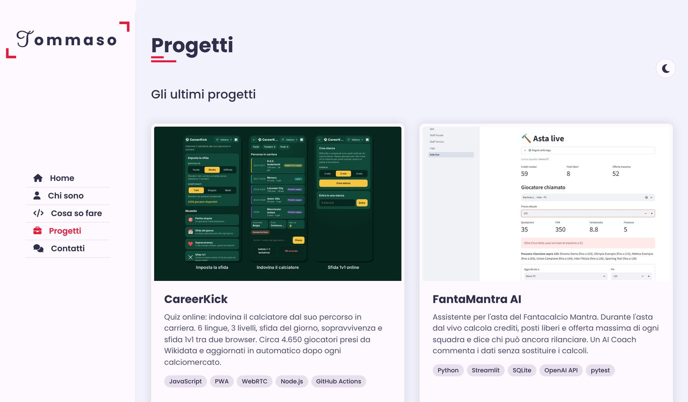

# Portfolio · Tommaso Dominici

Il mio sito personale: chi sono, cosa so fare, i miei progetti e come contattarmi.

**Sito online:** [demolitionweb.github.io/Project](https://demolitionweb.github.io/Project/)



## Cosa contiene

- **Home** con presentazione e scritta animata (Typed.js)
- **Chi sono** con formazione, esperienza e competenze
- **Cosa so fare**
- **Progetti** con immagini e link per provarli o vedere il codice: CareerKick, FantaMantra AI, Calcolatrice, Contatore
- **Contatti** con un modulo che apre il programma di posta con il messaggio già pronto
- **Tema chiaro e scuro**
- **Layout responsive**: su telefono il menu laterale diventa un menu a scomparsa

## Tecnologie

HTML · CSS (variabili CSS, Flexbox, media query) · JavaScript · Font Awesome · Typed.js · GitHub Pages

## Struttura

```
Home.html          pagina del sito
index.html         reindirizza a Home.html
Stile/             fogli di stile
js/script.js       navigazione tra sezioni, menu su telefono, modulo contatti
js/style-switcher.js
Immagini/          immagini del sito e dei progetti
```

## Provarlo in locale

Apri `Home.html` nel browser, oppure avvia un piccolo server dalla cartella del progetto:

```bash
python -m http.server 8000
```

e vai su http://localhost:8000/Home.html
